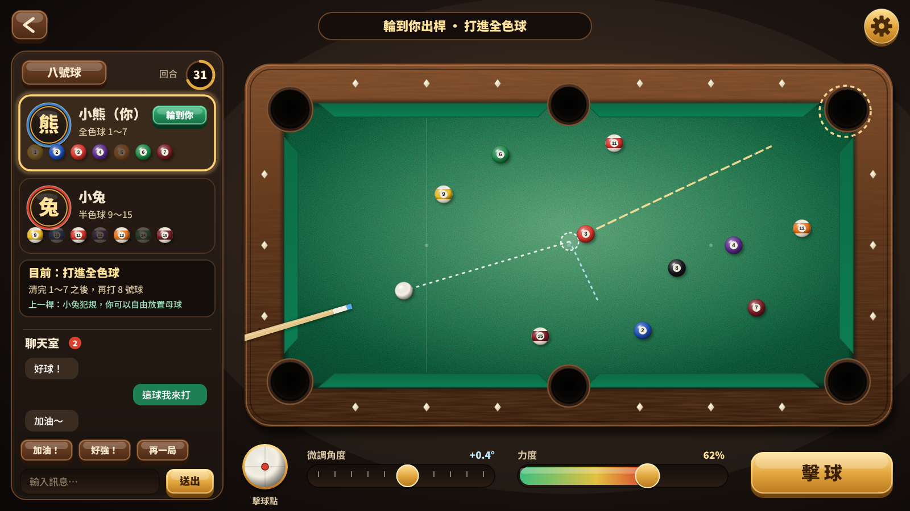
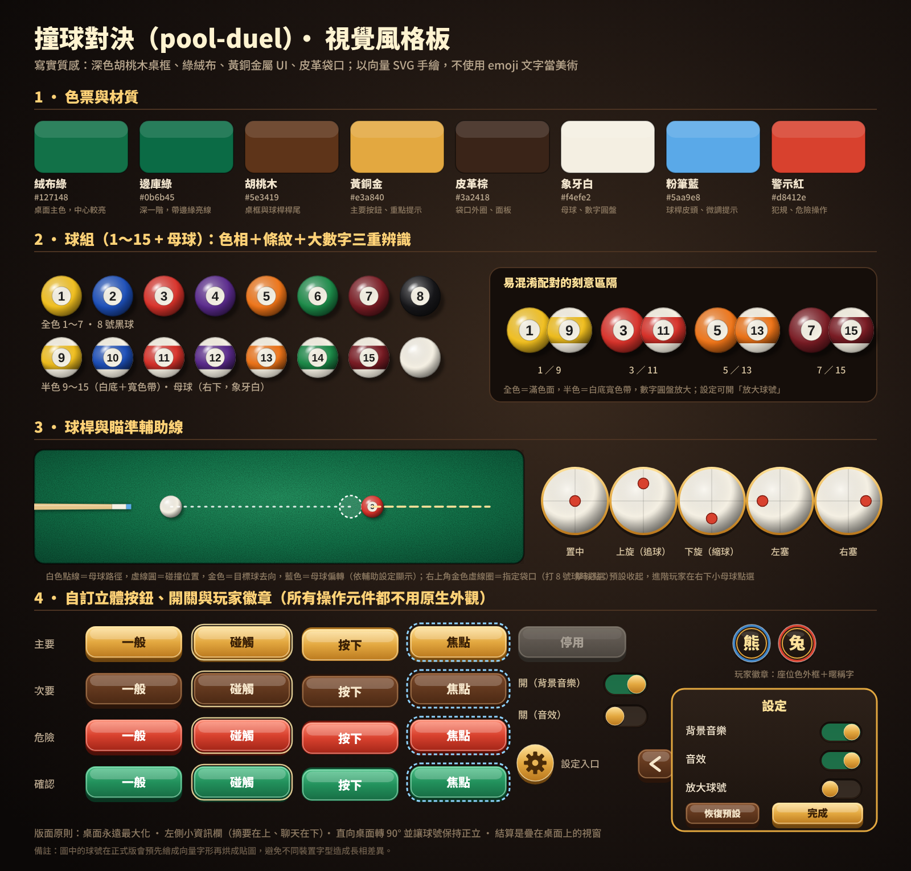

# 撞球對決（pool-duel）規劃書

> 遊戲正式名稱：**撞球對決**，專案代號 **`pool-duel`**，資料夾 `C:\Eric\AI Agent\pool-duel`。
>
> 狀態：**規劃完成，等你點頭就開工**。本文件是決策紀錄與施工圖；風格美術圖在 `美術/` 資料夾。
>
> 沿用 `C:\Eric\AI Agent` 既有小遊戲的架構慣例：Node 後端、`public/` 靜態前端、
> `public/js/rules.js` 共用純函式規則核心、`lib/rooms.js` 房間與權限、
> `public/js/config.js` 唯一 server URL 入口、`tests/verify.js`、`scripts/*-check.js`、
> `render.yaml`、`啟動遊戲.bat`，介面／註解／文件／commit 全繁體中文。
> 連線做法比照 **bubble-battle／stair-kids**：**零依賴**，自寫 WebSocket 伺服器（`lib/ws.js`），不引入 Express／Socket.IO。

---

## 0. 已確認的決定

以下每一項都是你在規劃問答中親自選的，實作期間不再自行變動；要改請直接說。

| 項目 | 決定 |
|---|---|
| 玩法規則 | **多種規則都做**：簡化九球、**八號球（正式規則）**、14-1 連續進球，房主建房／單機開局時選擇 |
| 八號球細節 | **只有打 8 號球要指定袋口**；開球沒達標＝犯規，對手選「接受現況」或「重擺重開」；開球 8 號球進袋，開球者選「重擺重開」或「8 號放回繼續」；**犯規桿進袋的球維持進袋、不放回**（WPA／APA 做法） |
| 玩家識別 | **不用動物頭像**：資訊欄與結算只顯示暱稱＋座位色徽章（玩家 1 藍、玩家 2 紅） |
| 人數 | **只做 2 人對戰**（不做 3～4 人輪流、不做 2v2 組隊） |
| 美術風格 | **寫實質感**：胡桃木桌框、綠絨布、皮革袋口、黃銅金屬 UI；風格圖見 `美術/` |
| 特色玩法 | **不加整人道具、不加障礙桌面，純撞球** |
| 瞄準與出桿 | **拖曳轉向＋獨立力度條**：手指在桌面拖曳轉動瞄準，另有「微調角度」滑桿與「力度」條，按「擊球」出桿 |
| 擊球點／旋轉 | **要做，但預設收起**：右下角小母球點選擊球點（上旋／下旋／左右塞）；預設置中不旋轉，進階玩家才打開 |
| 賽制 | **單局定勝負**，結算後可「再來一局」，不做多局累計 |
| 斷線 | **保留 30 秒，逾時判負**；30 秒內重連可繼續（回合制不需要立刻判輸） |
| 桌布與場景 | **桌布 3 款**（經典綠／深海藍／酒紅）＋**場景 3 款**（酒吧／俱樂部／咖啡廳）；只影響自己的畫面（存本機） |
| 球桿樣式 | **4 款可換**（楓木／黑檀金環／深海藍尾／紅木）；**同步給對手與觀戰者**看見 |
| 背景音樂 | **輕爵士酒吧風**，循環播放，可在設定關閉／調音量 |
| 首頁 | **俯視桌面＋豪華光影**：球在桌上滾動，三個按鈕（一個人玩／跟別人玩／怎麼玩） |
| 連線延遲 | 線上時於設定鈕旁顯示延遲徽章（綠／黃／紅） |

---

## 1. 風格美術（概覽）

四張圖都在 `美術/`（SVG 為正式向量檔，`預覽/` 為 PNG 預覽）：

| 檔案 | 內容 |
|---|---|
| `01-風格板.svg` | 色票與材質、1～15 號球與母球、易混淆球的區隔、球桿與瞄準輔助線、擊球點五種、立體按鈕四狀態、開關、玩家徽章、設定彈窗 |
| `02-遊戲畫面-橫向.svg` | 平板橫向／桌機：桌面最大化、左側資訊欄（摘要在上、聊天在下）、底部操作列、右上角設定 |
| `03-遊戲畫面-直向.svg` | 平板直向／手機：桌面旋轉 90° 且球號保持正立、頂部雙方摘要膠囊、左側抽屜把手（資訊＋聊天、未讀數） |
| `04-結算畫面.svg` | 疊在遊戲畫面上的結算視窗，三顆固定順序按鈕「再來一局／回到房間／回到首頁」 |





美術規則（實作時照著做）：

- **全手繪向量 SVG，不使用 emoji 文字美術**（系統字型會影響長相）。
- **球組**：標準 1～15 號色，8 號黑。**色相＋條紋＋大數字三重辨識**；全色＝滿色面、半色＝白底寬色帶；
  易混淆配對（1／9、3／11、5／13、7／15）刻意放大差異。符合你「要能清楚辨別避免玩家誤判」的長期要求。
- 球號正式版會**預先繪成向量字形再烘成貼圖**，不依賴裝置字型；直向時球貼圖反向旋轉，數字永遠正立。
- **桌面**：絨布有雜訊紋理與中心燈光、邊庫有亮線、袋口有皮革外圈、桌框有木紋與鑽石標記。
- **所有操作元件自訂立體外觀**（主要＝黃銅、次要＝胡桃木、危險＝紅、確認＝綠），四狀態：一般／碰觸／按下／焦點／停用；
  開關、滑桿、力度條、設定按鈕、返回鍵全部自繪，不裸用原生控制項；保留鍵盤、觸控、可見焦點與 ARIA。
- **玩家識別**：**不使用動物頭像**，改用**座位色徽章**（玩家 1 藍外框、玩家 2 紅外框、暱稱字置中）搭配暱稱文字；
  暱稱沿用隨機可愛暱稱（形容詞＋小動物），整體維持寫實質感。
- **音訊**：球碰球（依撞擊速度分三級）、擊球「叩」、庫邊悶響、進袋木球滾落、犯規提示、勝利。BGM 走輕爵士酒吧風、循環；
  全部用可替換、授權清楚的暫用資產。

---

## 2. 玩法規則（三種，共用同一套物理與判定核心）

### 2.1 共通規則

| 項目 | 規則 |
|---|---|
| 桌面 | 球桌座標 **1000 × 500**，球半徑 **15.6**（球徑／桌寬 ≈ 1/32，比真實桌略大，平板上看得清楚），六袋 |
| 輪流 | 兩人輪流出桿；**合法進球可繼續出桿**，沒進球就換人 |
| 犯規（共通） | ① 母球落袋 ② 沒有碰到任何球 ③ 先碰到不該碰的球（各規則定義）④ 碰球後沒有任何球進袋、也沒有任何球碰庫 ⑤ 回合超時 |
| 犯規處罰 | 對手獲得**自由球**（母球可放在桌面任何空位；拖曳母球放置）；不做「連續三次犯規判輸」 |
| 開球 | 球擺在腳點（置球點），開球者從開球線後出桿；九球與 14-1 **開球不判「四球碰庫」**（家庭友善），只判母球落袋；**八號球依正式規則判開球達標**（見 §2.3）；開球權每局**兩人互換**，第一局隨機 |
| 回合時間 | 預設 **45 秒**，房主可選 30／45／60／不限；超時視為犯規（對手自由球） |
| 勝負判定 | 各規則見下；**單局定勝負** |

### 2.2 簡化九球（預設，一局約 5 分鐘）

- 使用 1～9 號球，菱形擺放（1 號在頂、9 號在中心，其餘依種子亂數）。
- **必須先碰桌上號碼最小的球**，否則犯規。
- **9 號球合法進袋（含開球與連桿中的任何一桿）即獲勝**；9 號球在犯規桿進袋 → 放回置球點，不判勝。
- 合法進任何球可繼續出桿。

### 2.3 八號球（正式規則）

- 使用 1～15 號球，三角形擺放；一方打全色（1～7）、另一方打半色（9～15），**先清完自己花色再打進 8 號球者獲勝**。
- **開球達標**：開球時至少要有一顆球進袋，或至少 4 顆球碰庫。**沒有達標＝犯規**，對手出現選擇視窗：
  **「接受現況」**（取得自由球）或**「要求重擺重開」**（球重新擺好，由原開球者重新開球）。
- **開球時 8 號球進袋（母球沒進）**：開球者選 **「重擺重開」** 或 **「8 號球放回置球點，繼續打」**；選擇視窗只給開球者。
  開球時 8 號球與母球同時進袋：對手選「重擺重開」或「8 號放回置球點，並取得自由球」。
- **開放桌面**：開球後沒有花色；**第一個合法進袋的球（開球進袋不算）決定花色**。開放桌面可先碰任何球（不含 8 號球）；開放桌面時 8 號球進袋＝判負（開球除外）。
- **花色確定後**：必須先碰自己的花色；清完後必須先碰 8 號球。
- **指定袋口**：**只有打 8 號球時才需要**。清完花色後，出桿前必須**先點選目標袋口**（袋口會出現金色虛線圈並可點選），沒選就不能按「擊球」；
  8 號球進入**非指定袋口**＝判負。其他球不需指定，亂進也算。
- **8 號球判負的情況**：提前進袋；與母球同時進袋；在犯規桿進袋；進入非指定袋口。
- **犯規處罰**：對手獲得**自由球**；**犯規桿中進袋的球維持進袋、不放回桌面**（自己的球仍算進袋，對手的球也算對手少一顆）。
- 共通犯規 ①～⑤ 全部適用；沒有「連續三次犯規判負」。

### 2.4 14-1 連續進球（取代原「搶分賽」，內部代號仍為 score）

- 15 球三角形擺放（球號隨機），開球者開球，**開球不用叫球**，進袋的球照算分並繼續。
- **叫球**：之後每一桿都要先點要打的球、再點它要進的袋口（金色虛線圈）；叫的球進了指定袋口得 **1 分**（不論號碼），同一桿順便進袋的球也各得 1 分，繼續出桿。
- 叫的球沒進指定袋口：這桿不計分、進袋的球放回桌面（腳點），換對手。
- **安全球**：按「安全球」鈕宣告，不用叫球；這桿進袋的球放回桌面、不計分也不扣分，換對手。
- **犯規**（母球落袋、沒碰到球、碰球後沒有球進袋也沒有球碰庫）：**扣 1 分**、換對手、對手取得母球自由球；犯規桿進袋的球放回桌面。沒有「連續 3 次犯規扣 15 分」。
- **重新排球**：桌上只剩 1 顆球（14 顆已進袋）時，14 顆球重新排成三角形（**頂點空著**），剩下那顆與母球原地不動，輪到的人繼續出桿。
- **先達目標分數（預設 30 分）者獲勝**，沒有平手。
- 幼幼班（與自由練習）：不用叫球、不判犯規、每進一顆得 1 分。

### 2.5 難度四段（單機對電腦；差異必須看得出來）

| 難度 | 行為 | 輔助 |
|---|---|---|
| 幼幼班 | **袋口放大 25%**、不判犯規（母球落袋只重放）、電腦失誤很多（角度誤差 ±8°、力度隨機）、不會走位 | 完整輔助線、力度條有「推薦區」 |
| 簡單 | 找最近且路徑無阻的球直打，誤差 ±4°，不考慮走位與犯規後果 | 玩家可選完整／簡短輔助線 |
| 普通 | 依切角挑最容易的球與袋口，誤差 ±1.5°，**會避免母球落袋與留下難球**，沒球可打時打防守球 | 同上 |
| 困難 | 用**同一套物理引擎模擬多個候選桿**並向前看一桿（走位評分），會用擊球點與防守球，誤差 ±0.4°，不犯低級犯規 | 同上 |
| 神話 | 在困難的基礎上預演更多球路與力道（含定桿、拉桿、推桿與多段力度）、誤差約 ±0.06°，幾乎不失手；沒把握時打安全球 | 同上（只有單機） |

- 難度差異用「勝率單調遞增」測試驗證（見 §11），不是只改名稱。
- 幼幼班**只開放單機**（對戰時放大袋口會破壞公平）；線上房間的袋口大小由房主選「標準／加大」，雙方一致。
- 電腦出桿前顯示「思考中…」1～2.5 秒，並讓球桿做出瞄準動畫。
- **瞄準輔助**是玩家設定，與電腦難度分開：完整（含碰撞後路徑）／簡短（只到碰撞點）／關閉；線上房間由房主統一設定。

---

## 3. 物理與判定（最關鍵的技術決定）

### 3.1 可重現、可同步的確定性模擬

- 物理核心放在 `public/js/physics.js`，**純函式、無 DOM、無時間依賴**；瀏覽器與伺服器跑同一份。
- **固定步長 1/240 秒**；球速快時把每步切成最多 2 個子步，保證每個子步移動 < 球半徑一半，不穿透。
- 模擬內只使用 `+ − × ÷ Math.sqrt`（IEEE 規範下結果一致），**不用 sin／cos／pow**；
  出桿方向以**單位向量（量化成 1e-6 整數）**傳輸，避免三角函式在不同裝置上不一致。
- 隨機只用**可注入的種子亂數**（開球擺球順序、第一局誰開球），重播與 AI 測試可重現。

### 3.2 初始物理參數（試玩調校，只改 `public/js/physics-config.js`）

| 參數 | 初值 | 說明 |
|---|---|---|
| 球半徑 R | 15.6 | 球徑／桌寬 1/32 |
| 最大出桿初速 | 3600 單位／秒 | 力度 100% |
| 球球彈性係數 | 0.96 | 等質量球的碰撞 |
| 邊庫彈性係數 | 0.78（法向）、切向保留 0.92 | 邊庫吃掉部分速度 |
| 滾動減速 | 650 單位／秒² | 球越慢越快停 |
| 靜止門檻 | 速度 < 6 → 視為靜止 | 全部靜止才換人 |
| 袋口捕捉半徑 | 角袋 27、邊袋 25 | 加大袋口時 ×1.25 |
| 袋口邊緣圓 | 半徑 5，放在袋口兩側 | 球會被袋角彈開，產生「卡袋」手感 |

### 3.3 簡化旋轉（擊球點）

- 擊球點 (sx, sy) 落在母球半徑 0.6 內；預設 (0, 0)。
- **上旋／下旋**：母球碰到目標球後，沿原行進方向多走（追球）或往回縮（縮球），量與撞擊速度成正比。
- **左右塞**：影響母球碰邊庫的反彈角（偏向塞的方向），並讓出桿方向有微小偏移（出桿偏移量，隨 |sx| 增加）。
- 這是**簡化模型**，目的是有走位樂趣、不是完整剛體旋轉；數值在 `physics-config.js`。
- 幼幼班與簡單電腦不使用旋轉；設定可隱藏擊球點面板。

### 3.4 規則判定核心

`public/js/rules.js` 以**事件列表**判定每一桿：物理引擎輸出 `{ firstContact, cushionHits, pocketed[], cueScratched, finalState }`，
規則核心用三種規則各自的 `evaluateShot()` 回傳 `{ fouls[], continueTurn, nextBallInHand, winner, score, pendingChoice }`；
`pendingChoice` 用於八號球的「接受現況／重擺重開」與「重擺重開／8 號放回」選擇，由對應玩家在限時內回覆（超時採預設：接受現況、重擺重開）。
單機、線上、電腦模擬**全部共用這一份**，不另寫互相漂移的規則。

---

## 4. 連線同步

### 4.1 伺服器權威 + 回合制

- 輪到的玩家送出 `shot { angleVec, power, spin, cuePlacement? }`；伺服器驗證：輪到此人、力度在範圍、自由球放置位置合法。
- 伺服器用同一份 `physics.js` 模擬到全部靜止（模擬時間上限 30 秒保險），
  廣播 `shot`（輸入參數）與 `settle`（事件列表＋最終球位置＋狀態雜湊）。
- **客戶端收到 `shot` 就用同一份引擎本地播放動畫**（不必等伺服器逐幀串流）；收到 `settle` 時若最終位置與本地不同，直接校正。
- 回合制不需要像泡泡大作戰那樣的 tick 同步，頻寬極低，Render 免費層也夠用。

### 4.2 單機與線上共用同一套規則

單機＝同一份 `physics.js`＋`rules.js`＋AI 模組；線上伺服器只多了房間與權限。

### 4.3 斷線（照你的決定：保留 30 秒）

- 心跳連兩次沒回即視為斷線；**30 秒內重連**回到原席位，回合計時暫停到重連為止；**逾時判負**並通知對手與觀戰者。
- 重連後伺服器補送完整局面（球位置、輪到誰、花色／分數、聊天最近訊息）。
- 對手斷線時顯示倒數「對手斷線，30 秒後判你勝」。

---

## 5. 線上：大廳、房間、觀戰、邀請

- **大廳**：公開房列表、「快速加入」（沒房就自動開一間）、暱稱可編輯；不要求註冊。
- **房間設定（房主）**：規則（九球／八球／14-1）、回合秒數、瞄準輔助、袋口（標準／加大）；兩人席位，滿了後來者自動轉**觀戰**。
- **觀戰**：上限 **20 人**（滿了顯示「觀戰席已滿」）；可聊天、可看全桌（撞球沒有隱藏資訊）；觀戰者資訊欄與玩家相同，只多一行「你是觀戰者」。
- **邀請連結**：指向特定房間，**不自動用儲存的暱稱直接進房**：先停在大廳顯示房間與可編輯暱稱，確認後才用原房號＋邀請 token＋角色＋暱稱送出；
  伺服器消毒並限制暱稱，且**以 token 決定最終角色**，改暱稱不會改權限。
  邀請有範圍與撤銷狀態，與房間同生命週期，房主可撤銷重發；無效／已撤銷／房間已結束都有可理解的提示。
- **房間生命週期**：以**真人玩家**為準，兩個真人席位都空了（只剩觀戰者）→ 立即關閉房間、邀請失效、停止計時器、廣播 `closed`，
  觀戰者看到「房間已結束」與返回大廳入口；重連不能讓已關閉的房間復活。
- 房主可踢人，離開時自動換房主；**線上房間沒有電腦對手**（電腦只在單機）。
- **聊天**：自由輸入加快捷短語（加油！／好球！／好險！／哈哈／再一局／謝謝／掰掰）。

---

## 6. 畫面與操作

### 6.1 版面（依你的偏好：資訊欄放左邊、刻意小、桌面最大）

- **橫向（桌機／平板橫向）**：桌面最大化；左側可收合資訊欄，上方是**操作 Summary**（規則、回合倒數、雙方花色／分數、剩餘球、上一桿摘要、提示；八號球需要選擇時（開球達標、8 號開球進袋）在此顯示選擇視窗），
  下方是**聊天室**（錨定左下）；底部是操作列（擊球點、微調角度、力度、擊球）；右上角固定設定按鈕；觀戰者人數放資訊欄。
- **直向（平板直向／手機）**：桌面**旋轉 90°**（長邊直放）佔滿高度；頂部是雙方摘要膠囊；資訊與聊天收成**左側抽屜**（有未讀數、關閉／返回、斷線狀態）；
  操作列在底部兩排，「擊球」是最大的按鈕。
- 手機太窄時不強行維持 50／50，保留同一資訊優先順序。旋轉螢幕、鍵盤、觸控、觀戰與重連都維持一致的角色與權限。
- 所有畫面（首頁、模式選擇、大廳、房間、遊戲中、暫停、結算、載入、空白、錯誤、斷線、彈窗）都納入 RWD；
  以手機窄版、平板直／橫向、桌機寬版為檢查點，RWD 測試優先順序 **平板 > 桌機 > 手機**。

### 6.2 操作

| 操作 | 觸控 | 滑鼠／鍵盤 |
|---|---|---|
| 瞄準 | 在桌面任意處**拖曳轉動**瞄準方向；「微調角度」滑桿做 0.1° 精調 | 滑鼠拖曳；←／→ 微調；Shift 加細 |
| 力度 | 拖曳**力度條**（有刻度） | ↑／↓ 調整；滾輪 |
| 擊球點 | 點右下小母球選擇（預設置中、可收起） | 點選 |
| 擊球 | 按「**擊球**」大按鈕 | Space／Enter |
| 自由球 | 拖曳母球放置，放開確認（不合法位置顯示紅色） | 滑鼠拖曳 |
| 指定袋口（八號球打 8 號時） | 點選目標袋口（金色虛線圈），沒選時「擊球」按鈕停用並提示 | 滑鼠點選 |

- 為避免誤觸，**只有按下「擊球」才會出桿**；拖曳瞄準與調力度都不會擊球。
- 球桿有拉桿動畫；力度條與球桿後拉距離同步。

### 6.3 開局與流程

首頁大主視覺加三顆按鈕（一個人玩／跟別人玩／怎麼玩）→ 單機選規則與難度 → 擺球、開球動畫 → 對局 → 結算。

### 6.4 教學

**只做靜態圖文說明頁**（三種規則、操作方式、犯規說明、擊球點怎麼用），不做互動教學。

### 6.5 設定（右上角按鈕 → Modal 彈窗，不另開路由、不用抽屜）

背景音樂與音效**獨立**開關與音量、震動（手機）、瞄準輔助（完整／簡短／關閉）、擊球點面板顯示、**放大球號**、操作列左右對調、減少動態、色彩輔助。
所有控制自訂立體外觀；支援首次手勢後解鎖音訊、立即套用、重新進入保留、恢復預設、遮罩、焦點鎖定、關閉返回原焦點、Esc 與螢幕閱讀器。

### 6.6 結算

**疊在遊戲畫面上的 overlay**，不卸載桌面。內容：勝者徽章與「獲勝！」、結束原因、本局桿數、雙方進袋數／最長連桿／犯規數。
三顆固定順序按鈕：**再來一局**（互換開球權）／**回到房間**／**回到首頁**。單機的「回到房間」改為回到規則設定，並顯示一行說明。

---

## 7. 資料與紀錄

- 本機儲存：暱稱、設定、簡單戰績（勝場、最長連桿、進袋數）；**不做伺服器排行榜**，房間視為可清理的暫時狀態。
- 房間狀態存在伺服器記憶體；Render 休眠或重啟時，房間會消失，重連失敗時顯示可理解的提示並導回大廳。

---

## 8. 檔案結構（預定）

```
pool-duel/
├─ README.md、規劃書.md、package.json、render.yaml、啟動遊戲.bat、.gitignore、.env.example
├─ server.js                 # 靜態檔與 WebSocket 入口、/health
├─ lib/ws.js、lib/rooms.js、lib/chat.js
├─ public/
│  ├─ index.html、css/、assets/（球貼圖、桌面、徽章）
│  └─ js/
│     ├─ config.js           # 唯一 server URL 入口（GAME_SERVER_URL）
│     ├─ physics.js、physics-config.js   # 確定性物理
│     ├─ rules.js            # 三種規則判定
│     ├─ ai.js               # 四段電腦
│     ├─ render.js、input.js、audio.js、settings.js、net.js、ui/
│     └─ themes/ball-art.js  # 球貼圖資料（純資料，可替換）
├─ tests/verify.js、scripts/online-check.js、scripts/layout-check.js
└─ 美術/                     # 風格板與版面圖
```

---

## 9. 里程碑（薄切優先，每階段都能玩）

| 階段 | 內容 | 驗收 |
|---|---|---|
| M0 | 物理核心＋九球單機（自己打、無電腦）、拖曳瞄準＋力度條＋擊球 | 能從開球打到 9 號進袋 |
| M1 | 八號球、14-1、犯規與自由球、結算 overlay、設定彈窗 | 三種規則完整一局 |
| M2 | 電腦四段、擊球點旋轉、瞄準輔助三級 | AI 勝率單調、旋轉有可見效果 |
| M3 | 線上大廳、房間、2 人對戰、斷線重連、計時 | 兩個瀏覽器完整對局 |
| M4 | 觀戰、邀請連結、聊天室、踢人、房間自動關閉 | 角色權限測試全過 |
| M5 | RWD 全畫面（橫向／直向／手機）、音訊、說明頁、game-lobby 整合 | 平板橫直向版面檢查 |
| M6 | 打磨與部署準備（Render 新加坡、GitHub Pages） | 正式建置、本機 `啟動遊戲.bat` 一鍵可玩 |

---

## 10. 測試與驗收清單

- **物理**：同輸入兩次模擬結果完全相同（狀態雜湊一致）；球球碰撞動量守恆；高速球不穿透；球靜止判定；袋口捕捉與袋角彈開。
- **規則**（單元測試，三種規則各一組）：先碰球犯規、母球落袋、無球碰庫、9 號進袋勝、14-1 叫球、安全球、犯規扣 1 分、14 顆重新排球、自由球放置合法性；
  八號球另測：開球達標與否、開球未達標的兩種選擇、8 號開球進袋的選擇、開放桌面花色判定、指定袋口（進錯袋判負、未指定不能擊球）、
  8 號提前進袋／與母球同進／犯規桿進袋判負、犯規桿進袋的球維持進袋、選擇視窗超時預設值。
- **電腦**：四段電腦互打 200 局，勝率須單調遞增；單桿決策時間在預算內（< 150 ms，分段不卡 UI）；幼幼班不犯規；八號球打 8 號時電腦會自己指定袋口，且普通以上不會指定到打不進的袋。
- **線上**：房間生命週期（兩個真人席位皆空即關閉、邀請失效）、重連 30 秒內保留席位／逾時判負、觀戰與加入角色權限、邀請 token 範圍／撤銷／過期／已結束、暱稱消毒、伺服器拒絕不合法出桿（不是輪到者、力度超範圍）。
- **版面**：手機／平板直橫向／桌機截圖檢查（`scripts/layout-check.js` 產生 `screenshots/`）；桌面最大化、左側資訊欄不遮操作；直向桌面旋轉且球號正立。
- **操作與無障礙**：觸控拖曳瞄準、微調滑桿、力度條、擊球按鈕、自由球拖曳；所有自訂按鈕與開關的鍵盤、焦點、ARIA；右上角設定流程與靜音／音量。
- **結算 overlay**：三顆按鈕在單機與線上都正確執行或說明不可用，且不遮蔽結算資訊。
- **部署**：server URL 參數化（`GAME_SERVER_URL`）、`.gitignore`／`.env.example`／啟動與建置說明、正式建置。
- 報告時**只宣稱實際執行過的驗證**，沒能執行的列出來。

---

## 11. 部署與版控

- 本機 git repo（lockfile、`.gitignore`、`.env.example`）；commit 訊息全繁體中文。remote 預設 `https://github.com/PJH-Eric/pool-duel.git`，
  Claude 這端沒有憑證推不上去，要你自己 `git push -u origin main`；未經你授權不自行 push、建雲端服務或設定網域。
- 發布拓撲：前端靜態檔走 **GitHub Pages**（Actions 建置時讀 repository variable `GAME_SERVER_URL` 注入）；後端走 **Render 免費層**，
  `render.yaml` 的 Web Service **明確指定 `region: singapore`**（注意：既有服務不能改 region，需重建並更新 `GAME_SERVER_URL`）。
- 提供 `/health`、啟動失敗的可讀錯誤、優雅斷線與重連；Render 冷啟動時顯示喚醒動畫。
- 完成後加進 **game-lobby**（新的一款，卡片 badge「新遊戲」）。

---

## 12. 我自己先決定、你可以否決的細節

規劃問答的決定都照你選的寫進上面了。以下是我先定好的細節，不同意就說：

1. **名稱與代號**：撞球對決／`pool-duel`；**本機 port 3160**（3000～3140 已被其他遊戲用掉，3100 是大富翁）。
2. **不做同一台平板輪流（同機雙人）**：與你其他遊戲的決定一致；單機對電腦＋線上 2 人。
3. **單機另有「自由練習」**（一個人隨意擊球、沒有勝負）可練手感；你說只做 2 人對戰，若不要我就拿掉。
4. **線上房間沒有電腦對手**（電腦只在單機），跟你畫我猜一致。
5. **幼幼班只開放單機**；線上由房主選袋口「標準／加大」。
6. **開球權每局互換**，第一局隨機；**九球維持家庭友善的簡化**（不判四球碰庫）；14-1 開球同樣不判四球碰庫，八號球照你的決定走正式規則。
7. **回合時間預設 45 秒**，房主可選 30／45／60／不限；八號球的選擇視窗限時 15 秒。
8. **玩家識別用座位色徽章**（玩家 1 藍、玩家 2 紅），沒有動物頭像，照你的決定。
9. **球徑略大於真實比例**（球徑／桌寬 1/32），讓平板上看得清、點得準。
10. **只做繁體中文**，不抽語言檔；BGM 與音效預設都開。
11. **正式美術與音訊**：我會先做可用的手繪 SVG（球組、桌面、徽章）與可替換的暫用音效；之後要換指定資產，`public/js/themes/*.js` 純資料格式會保持可替換。

確認以上之後，就從 **M0（物理核心＋九球單機薄切）** 開始實作。

---

## 13. 實作完成紀要（M0–M6 全部完成）

- **狀態**：三種規則、四段 AI、自由練習、線上房間／觀戰／邀請／聊天／斷線重連、RWD（橫向／直向／手機／平板）、
  音效與 BGM、設定、教學頁皆已完成；`npm run verify` 全數通過。
- **已實測**：無頭瀏覽器跑過首頁、設定、單人對戰、練習、擊球點彈窗、兩人線上對局、觀戰、邀請連結落地頁，
  以及 1600×900、1180×820、820×1180、844×390、390×844 等尺寸，無主控台錯誤、無橫向捲動。
- **規則細節的實作決定**：電腦不會在線上出現；幼幼班只在單機；14-1 目標 30 分、犯規 −1（幼幼班不扣）。
- **部署**：尚未建立任何雲端服務。`render.yaml`、`.github/workflows/pages.yml` 已備妥，網址待你建好服務後填入。
- **大廳**：已在 `game-lobby/config/games.json` 加入卡片（本機 port 3160）。

### 13.1 追加：推桿／定桿／拉桿／跳桿 與更真實的滑動

- **擊球快捷**：擊球點旁新增 4 顆按鈕（推桿、定桿、拉桿、跳桿；快鍵 1／2／3／4，0 取消），再按一次同一顆＝取消；每桿用完自動回到正中央。
- **推桿**＝打母球偏上，碰球後母球往前追；**拉桿**＝偏下，碰球後往回縮；**定桿**＝剛好偏下一點點（由 `E_BALL` 與 `FOLLOW_K` 算出，約 0.04），正撞時母球停在碰撞位置，遠近距離都驗證過（旋轉衰減調得很小才能長距離穩定）。
- **瞄準線預測**：選了推／定／拉之後，白色短線即時顯示母球碰球後的走向與長度（定桿幾乎只剩一小截）。
- **跳桿**：母球飛過擋路的球再落地；飛行距離＝130＋330×力度（約 130～460 單位），飛行中沒有摩擦、不碰地上的球、不進袋，落地損失 20% 速度；跳桿時不能同時用推／定／拉桿。瞄準線畫出拱形飛行段與落點黃圈；畫面上母球會變大、浮起並有縮小的影子。落地後第一個碰到的球仍須合規則。線上同步（`shot.jump`），困難電腦在被擋住、沒有直接路線時會試跳桿飛過去（實測約 8% 的桿數）。
- **更貼近現實的滑動**：球改成「先滑後滾」兩段摩擦（滑動 560、純滾動 200；滑到 5/7 速度後轉為滾動），被擊到的球比以前滑得遠約 2 倍；全力一桿仍在 9 秒內停止。電腦估力道改用等效減速 `DECEL_EFF`。

### 13.2 追加：袋口再小一點、資訊欄可收合

- 袋口縮小約 6%，之後又再縮約 6%：袋口缺口 36→32／30→26、進袋判定半徑 27→23.5／25→21.5，桌面上的袋口圖也同步縮小。
- 橫向時左邊資訊欄的 × 與 ☰ 原本沒有作用，現在 × 會收起資訊欄、桌面變最大；桌面左上角的 ☰ 再展開（直向／手機仍是抽屜）。

### 13.3 追加：操作與版面優化（依你逐項回覆的選擇）

- **擊球點直接看得到**：瞄準時母球上顯示紅點（俯視：上旋偏前、下旋偏後、側旋偏左右），球桿尖端也隨側旋偏到左／右側；按鈕區塊在選了模式後會顯示模式名稱（推桿／定桿／拉桿／跳桿）。
- **防呆**：八號球沒選袋口就按擊球，所有可選袋口紅色閃爍；選了跳桿但直線上第一個碰到的就是合法目標時，畫面提示「前面沒擋球，不用跳」（只提示，不禁止）。
- **版面**：手機橫向預設收起資訊欄，只留上方兩個頭像／分數膠囊（可用 ☰ 展開）；小螢幕（直向、手機）時推／定／拉／跳四顆收進「擊球點」面板；對局中所有提示統一顯示在桌面上方。
- **資訊欄**：九球標出「下一顆該打的最小號球」（金框閃動）；八號球清完花色後，8 號球出現在清單並標出為下一顆。
- **原本就有、不另外做**：進袋／犯規音效與手機震動（設定可關）、結算畫面的統計（進袋數、最長連進、犯規數）。
- **你選擇不做**：長按放大鏡、拉桿式出桿、回放、擺球練習、賽制與電腦表現選項、跳桿限制、九球推出選項、14-1 目標分數選項。

### 13.4 修正：進袋判定與畫面黑洞對齊

- 之前進袋判定是以「桌角／庫邊中點」為圓心，而畫面上的黑洞圓心往桌外偏（角袋 7、邊袋 9），縮小袋口後兩者落差變明顯：球看起來已經壓在黑洞上卻沒掉。
- 現在判定與畫面共用同一組數字（`HOLE_R_*`、`HOLE_OFF_*`，`physics-config.js`）：球心進到黑洞範圍（外緣再加 3 單位寬容度）就掉進袋；驗證裡新增六個袋口的邊界測試。
